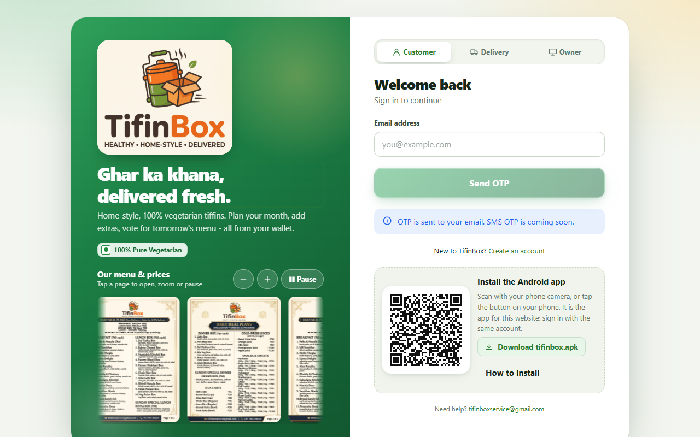

# TifinBox for Android

**100% vegetarian home-style tiffins - plan your month, add extras, vote for tomorrow's menu, all from one wallet.**

This repository only hosts the **Android app** (`tifinbox.apk`) of the TifinBox service. The app is not on the Play Store yet, so you install it from this page.

> **This app works with the TifinBox website you signed in to.** It is the same service and the same account: install the app, then sign in with the e-mail address you use on the website. You do not need a separate registration.

<p align="center">
  
</p>

## Download

| | |
|---|---|
| **Latest version** | 1.127 (06 Nov 2026) |
| **File** | `tifinbox.apk` (30.8 MB) |
| **Needs** | Android 7.0 or newer, 64-bit phone (almost every phone since 2017) |
| **Download** | **[tifinbox.apk](https://github.com/Pandey-Vikas/tifinbox-android/releases/latest/download/tifinbox.apk)** |

You can also scan the QR code on the sign-in page of the TifinBox website with your phone camera - it opens the same download.

SHA-256 of the file (to check that it was not changed on the way):

```
406ca95d1a4239352808f9feb5d0e411dbec3e4f7e11787824783fc3e16d47e2
```

## Install (about one minute)

1. Open the download link above **on your phone** and download `tifinbox.apk`.
2. Open the downloaded file. If Android says *"For your security, your phone is not allowed to install unknown apps from this source"*, tap **Settings** and switch on **Allow from this source** for your browser (or the Files app), then go back.
3. Tap **Install**. If Google Play Protect shows *"App blocked / Unsafe app"* because the app does not come from the Play Store, tap **More details** and then **Install anyway**.
4. Open **TifinBox**, choose **Customer**, enter your e-mail and the code that is sent to you. Your fingerprint or a PIN can be switched on afterwards.

You can switch "Allow from this source" off again after the installation.

## Updates

Install the newer `tifinbox.apk` over the old one - your sign-in, wallet and orders stay (they live in your account, not in the phone). Every release here is signed with the same key, so Android accepts it as an update.

## Share the app with a friend

Inside the app: **Profile -> Share the app** hands the app file to *Nearby Share*, Bluetooth, or any app on your phone - no internet needed. **Profile -> Install QR code** shows a QR that another phone can scan to download it.

## What the app does

- **Customers** - monthly tiffin plan with a tap-to-skip calendar, a la carte extras, snacks, wallet and top-up, voting for tomorrow's menu, live order timeline, ratings and in-app notifications.
- **Delivery partners** - the day's stops with map and QR / manual delivery confirmation.
- **Owner** - the full control panel (menu, rate card, payments, ledger, feedback) is on the website; the app has the daily essentials.

Everything is vegetarian only.

## Privacy and security

- The app talks only to the TifinBox service over HTTPS.
- Sign-in is by e-mail one-time code (or Google); there is nothing to remember or type except the code.
- The app asks for camera (scanning QR codes), location (delivery partners) and fingerprint (optional sign-in).

## Questions

Write to the support address shown on the sign-in page of the website.

---

*All rights reserved. This repository contains only the compiled app for TifinBox customers, delivery partners and staff.*